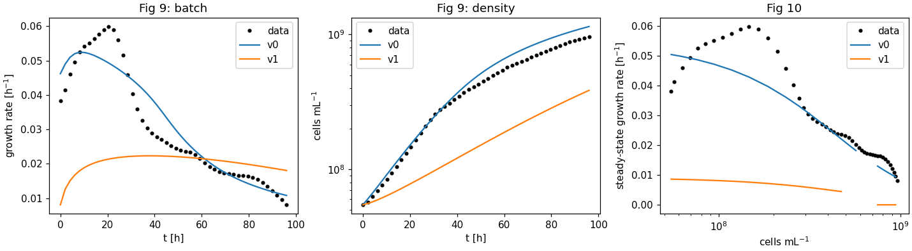

# v1 (bug-fixed) vs v0: robustness and fit to the batch data

Model: `synmep.models.v1_fixed` (fix log: ADR 0002 §5). Scripts:
`scripts/robustness_v0_v1.py` → `v1-robustness.json`, `scripts/v1_figures.py` →
`v1-figures.json`, `figures/v1-fig9-fig10.png`. v1 is **not recalibrated**.

## Robustness under parameter perturbations

24 samples per group, every parameter in the group scaled by an independent
log-uniform factor in [0.1, 10] (same seeds for v0 and v1); steady state (dshc, density
of data row 24). "native" = Native(CVODE_BDF) steady-state search succeeds; "any" =
native or the Sundials fallback.

| group (n params)    | v0 native | v0 any | v1 native | v1 any | v0 s/sample | v1 s/sample | v1 μ range [h^-1] |
| ------------------- | --------- | ------ | --------- | ------ | ----------- | ----------- | ----------------- |
| kcat (17)           | 75 %      | 88 %   | 29 %      | **100 %** | 4.8      | 4.3         | 0.002–0.014 |
| ksynth (15)         | 96 %      | 100 %  | 17 %      | **100 %** | 0.7      | 4.2         | 0.002–0.023 |
| out_metabolism (4)  | 83 %      | 92 %   | 17 %      | **100 %** | 0.9      | 4.1         | 0.002–0.013 |
| light (1)           | 58 %      | 71 %   | 83 %      | **96 %**  | 4.3      | 1.2         | 2e-8–0.018  |
| cell density (0)    | 79 %      | 96 %   | 38 %      | 67 %      | 1.3      | 7.8         | 0.006–0.010 |

- **Robustness to kinetic and light perturbations improved**: with the Sundials fallback
  v1 reaches a positive steady state in 100 % (kcat, ksynth, sinks) and 96 % (light) of
  samples, vs. 71–100 % for v0. The light failures of v0 (extrapolating surrogate, ADR
  0002 §3) are gone except one sample; the bounded surrogate returns ~0 growth at very
  low light instead of failing.
- **Native's steady-state search fails much more often on v1** (17–38 % success in most
  groups) although the steady states exist. The slow modes of v1 (enzymes and pigments
  relaxing at μ ~ 0.002–0.01 h^-1) make the convergence criterion hard to meet within
  Native's step budget; Sundials converges. Per-sample time is therefore dominated by
  the fallback.
- **Cell density is the weak spot of v1** (67 %): at high densities supply drops below
  maintenance, Chl synthesis and μ approach zero and steady states take very long to
  reach (or μ → 0, counted as failure).

## Fig 9 / Fig 10

| | v0 | v1 |
| --- | --- | --- |
| Fig 9 RMSE growth rate [h^-1] | 0.0053 | 0.0195 |
| Fig 9 RMSE ln N | 0.135 | 0.899 |
| Fig 10 RMSE growth rate [h^-1] | 0.0071 (22/24 converged) | 0.0322 (19/24) |

v1 grows ~2.5× too slowly (peak 0.022 vs. 0.06 h^-1). The per-fix table in ADR 0002 §5
shows where the fit was lost: B6 (µM defaults, overshoot), B9 (4 fL halves Chl* and
enzymes), B2 (supply ÷ 3.15) and B3 (resource-coupled drain) each move growth by a
factor 2–3, in partly opposing directions. The legacy parameter set fits the data
*because* these errors compensate each other.

## Open questions

1. **Recalibration of v1** (needed before Figs 11/12 mean anything): which parameters to
   fit? Candidates: `chl_growth_slope` (only reproduces Chl* = measured Chl if
   ×0.32), a PETC supply scale (thread g needed 5.5), `rho_DW`.
2. **`chl_growth_slope`**: with the legacy value Chl* = 6.3 mM at 4 fL vs. a measured
   19.9 mM. The slope's derivation isn't in the repo.
3. **Dry-weight density** (ρ_DW = 970 g L^-1, ~3× physiological), shared with thread g.
4. **DXS synthesis activated by DXS_nonactive** (`DXS_synth_f`) isn't described in the
   paper; kept.
5. **Native steady-state search** gives up on slow systems (all three Native methods
   fail on v1 at default parameters); Sundials is the fallback.
