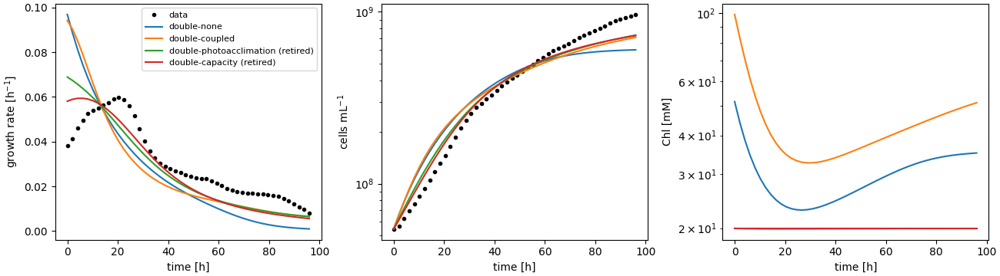

# `double` family: ground-up three-timescale model

Design: ADR 0004. Code: `synmep.petc.pfennig`, `synmep.models.metabolism`,
`synmep.models.double_growth`, `synmep.surrogates.poly`; scripts `train_petc_surrogate.py`,
`train_metabolism_surrogate.py`, `fit_double.py`, `plot_fits.py double`.
(Formerly thread "g"; names per ADR 0006.)

## Pipeline

| Layer      | Model                                     | Surrogate (inputs → outputs)                         | Training                         | Hold-out accuracy |
| ---------- | ----------------------------------------- | ---------------------------------------------------- | -------------------------------- | ----------------- |
| PETC (s)   | pfennig2024, native-lowerable, 3PGA clamped | 4 absorbed-light inputs → J_3PGA, J_ATP (degree 5) | 4000 culture states via the light model, ~1 min | R² 0.976 / 0.925 |
| metabolism (min) | 7-pool ODE, saturable kinetics       | S_PGA, S_ATP, E_CrtE → μ, Chl*, Car*, SQ* (degree 6, log-log) | 4000 physically produced supplies, ~1.5 min | median 3 %, p95 16–21 % |
| growth (h) | N, Chl, Car, SQ ODEs                      | —                                                    | fit: 2 parameters, ~25 s         | see below         |

## Fit to the batch data (Fig 9 data)

Current model: PETC evaluated at 5 Gauss–Legendre depths of the light profile and
averaged (5 nm wavelength grid), low-light extension of the PETC surrogate, pigment
targets X* relaxed at rate μ. Pigment-regulation variants (the last two are retired,
ADR 0006):

| variant | fitted | RMSE μ [h^-1] | RMSE ln N | pigments |
| --- | --- | --- | --- | --- |
| depth-averaged PETC, unregulated (previous) | petc 5.48, pbs 1.26 | 0.0133 | 0.232 | carotenoids ~240 mM in pre-culture |
| `double-none`: depth-resolved, unregulated | petc 1.18, pbs 1.36 | 0.0165 | 0.255 | runaway: carotenoids ~3000 mM in pre-culture |
| `double-coupled`: pigment-branch enzymes ∝ μ/μ_ref | petc 1.25, pbs 9.13 | 0.0164 | 0.228 | bounded (Chl 30–100, Car 8–17 mM) |
| `double-photoacclimation` (retired): X* = X_ref (1+a)/(1+a L_rel) | petc 1.93, pbs 1.79, a 0.007 | 0.0097 | 0.156 | constant at reference (a → 0) |
| `double-capacity` (retired, added after this report's first version): capacity acclimation, fixed pigments | petc 2.57, pbs 1.89, K 59, τ 6000 min | **0.0077** | **0.141** | constant at reference |
| `single-legacy` (for reference, not refitted) | — | 0.0053 | 0.135 | pinned Chl |

Findings:
- **Depth resolution removes the unexplained PETC efficiency factor** (5.5 → 1.2–1.9):
  evaluating the nonlinear PETC at the depth-averaged light was the main reason a large
  supply correction was needed.
- Without pigment regulation, the dense, dark pre-culture falls into a **dark trap**:
  more pigment → more self-shading → less supply → higher pigment targets. Carotenoid
  contents of 36 mg mg(Chl)^-1 push every surrogate input off its training manifold.
- **`double-photoacclimation` fits better than the pigment-dynamic variants, but by
  switching acclimation off** (a ≈ 0): constant pigment contents. `double-coupled` bounds
  the pigments but fits no better than `double-none` and needs an implausible
  phycobiliprotein factor.
- **No pigment variant reproduces the initial rise** (0.038 → 0.06 h^-1 over 20 h). In this model
  more pigment means more absorbed light, so pigment dilution after the transfer to
  brighter conditions can't raise growth. The rise more likely reflects acclimation of
  photosynthetic *capacity* (e.g. CBB / photosystem amounts) to the higher light over
  hours. `double-capacity` (a slow capacity state) captures part of it and fits best.
- Speed: one fit evaluation takes ~1 s after a ~70 s compile (was 45 s per evaluation:
  Native's steady-state search ran its full 1000 iterations on the pre-culture state;
  replaced by a single long time course in steady mode, where states relax at 1 min^-1).

## What happened next

1. Capacity acclimation was added (`double-capacity`, above) and later became an option
   for every family (ADR 0006).
2. Constant pigment contents were *not* adopted: they remove the squalene/pigment
   trade-off that the productivity question needs (report 05). The fixed-pigment
   variants are retired.
3. The dry-weight inconsistency was resolved in `minimal-m0` (report 06).
4. Fig 12 for this family runs on the coupled ODE model (report 04).
