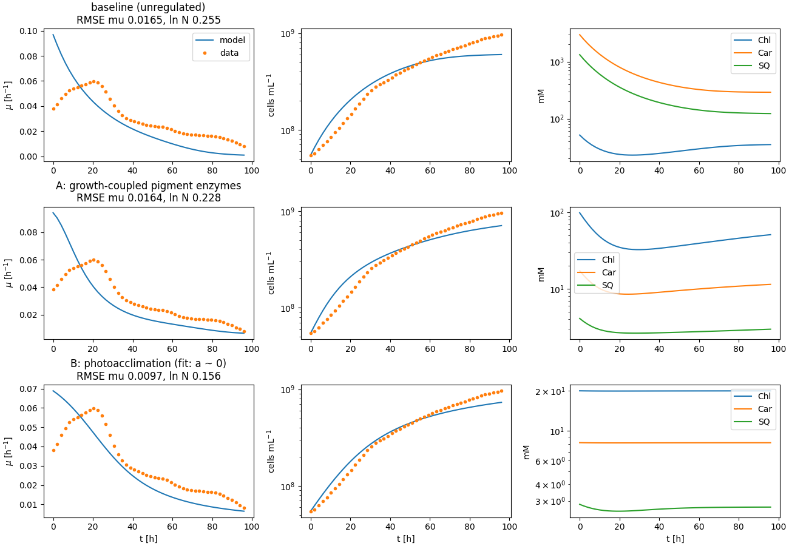

# Ground-up three-timescale model (thread "g"): status

Design: ADR 0004. Code: `synmep.petc.pfennig`, `synmep.models.g_metabolism`,
`synmep.models.g_growth`, `synmep.surrogates.poly`; scripts `train_petc_surrogate.py`,
`train_metabolism_surrogate.py`, `fit_g_growth.py`.

## Pipeline

| Layer      | Model                                     | Surrogate (inputs → outputs)                         | Training                         | Hold-out accuracy |
| ---------- | ----------------------------------------- | ---------------------------------------------------- | -------------------------------- | ----------------- |
| PETC (s)   | pfennig2024, native-lowerable, 3PGA clamped | 4 absorbed-light inputs → J_3PGA, J_ATP (degree 5) | 4000 culture states via the light model, ~1 min | R² 0.976 / 0.925 |
| metabolism (min) | 7-pool ODE, saturable kinetics       | S_PGA, S_ATP, E_CrtE → μ, Chl*, Car*, SQ* (degree 6, log-log) | 4000 physically produced supplies, ~1.5 min | median 3 %, p95 16–21 % |
| growth (h) | N, Chl, Car, SQ ODEs                      | —                                                    | fit: 2 parameters, ~25 s         | see below         |

## Fit to the batch data (Fig 9 data)

Current model: PETC evaluated at 5 Gauss–Legendre depths of the light profile and
averaged (5 nm wavelength grid), low-light extension of the PETC surrogate, pigment
targets X* relaxed at rate μ. Three pigment-regulation variants:

| variant | fitted | RMSE μ [h^-1] | RMSE ln N | pigments |
| --- | --- | --- | --- | --- |
| depth-averaged PETC, unregulated (previous) | petc 5.48, pbs 1.26 | 0.0133 | 0.232 | carotenoids ~240 mM in pre-culture |
| depth-resolved, unregulated | petc 1.16, pbs 1.36 | 0.0165 | 0.255 | runaway: carotenoids ~3000 mM in pre-culture |
| **A**: pigment-branch enzymes ∝ μ/μ_ref | petc 1.25, pbs 9.13 | 0.0164 | 0.228 | bounded (Chl 30–100, Car 8–17 mM) |
| **B**: photoacclimation X* = X_ref (1+a)/(1+a L_rel) | petc 1.93, pbs 1.79, a 0.007 | **0.0097** | **0.156** | constant at reference (a → 0) |
| legacy v0 (for reference, not refitted) | — | 0.0053 | 0.135 | pinned Chl |

Findings:
- **Depth resolution removes the unexplained PETC efficiency factor** (5.5 → 1.2–1.9):
  evaluating the nonlinear PETC at the depth-averaged light was the main reason a large
  supply correction was needed.
- Without pigment regulation, the dense, dark pre-culture falls into a **dark trap**:
  more pigment → more self-shading → less supply → higher pigment targets. Carotenoid
  contents of 36 mg mg(Chl)^-1 push every surrogate input off its training manifold.
- **Variant B fits best but by switching acclimation off** (a ≈ 0): constant pigment
  contents, the simplest possible regulation. Variant A bounds the pigments but fits no
  better than the unregulated model and needs an implausible phycobiliprotein factor.
- **No variant reproduces the initial rise** (0.038 → 0.06 h^-1 over 20 h). In this model
  more pigment means more absorbed light, so pigment dilution after the transfer to
  brighter conditions can't raise growth. The rise more likely reflects acclimation of
  photosynthetic *capacity* (e.g. CBB / photosystem amounts) to the higher light over
  hours.
- Speed: one fit evaluation takes ~1 s after a ~70 s compile (was 45 s per evaluation:
  Native's steady-state search ran its full 1000 iterations on the pre-culture state;
  replaced by a single long time course in steady mode, where states relax at 1 min^-1).

## Next steps (proposed)

1. Capacity acclimation: a slow state for photosynthetic capacity (e.g. `petc_scale`
   relaxing on an hours timescale towards a light-dependent target) to explain the rise.
2. Adopt constant pigment contents (variant B with a = 0) as the default unless a
   capacity-acclimation model brings pigment acclimation back into play.
3. Resolve the dry-weight / cell-volume inconsistency before interpreting `petc_scale`.
4. Then Figs 10–12 for this thread (Fig 12 via the coupled ODE model, not the surrogate).
