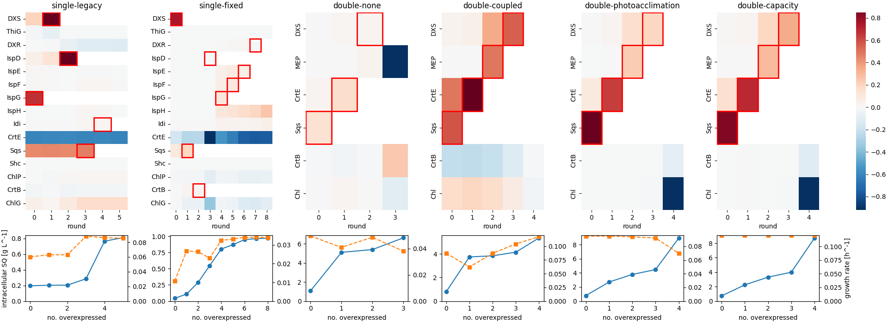

# MCA-based strain optimisation (Fig 12) for all model variants

Script: `scripts/strain_optimisation.py` (→ `strain-optimisation.json`), figure:
`scripts/plot_strain_optimisation.py`.

## Procedure

As in the notebook / paper Fig 12, with **each enzyme overexpressed at most once**:

1. Steady growth at fixed cell density 1e7 cells mL^-1, light 100 µmol m^-2 s^-1, sample
   depth 1 cm (the notebook's conditions), Δshc strain.
2. Normalised flux response coefficients of squalene synthesis and of biomass synthesis
   to every enzyme parameter. Score = sum of the two.
3. A step is only taken if its control is positive: score > 0 **and** a positive
   response of the intracellular squalene content (state `SQ`); lowering the squalene
   content is pointless. Among those, the enzyme with the highest score is
   overexpressed, unless the realised (large) step lowers the steady-state squalene
   content anyway; then it is rejected and the next one tried.
4. Repeat until no enzyme passes (or every enzyme was used once, max 10 rounds). Round 1
   answers "which *single* overexpression is best".

Overexpression is a fold change of the enzyme: `single` scales the enzyme's synthesis
rate, `double` and `minimal` its level, by `1 + 1.331057 kDa / (2 E0)` (E0 = legacy proteomics
concentration). For single-legacy this is exactly the notebook's additive
`ksynth + 1.331057 kDa / (5.5 h)`. `double` and `minimal` lump DXR…IspH into one "MEP" enzyme, which
gets the geometric mean of their folds (in reality that's several genes). ChlP/ChlG are
one lump ("Chl").

`double` uses `models/double.py`: the explicit metabolism ODE coupled to the growth
layer at fixed density, because the metabolism surrogate only has E_CrtE as an input.
Parameters come from each variant's batch fit.

## Results

Top: score per enzyme and round (red boxes = chosen). Bottom: intracellular squalene
(blue, g L^-1) and growth rate (orange, h^-1) after n overexpressions.

| variant | single best | order (until no positive step is left) | SQ start [g/L] | after 1 | end | μ start [1/h] | μ end | rejected (round: enzyme) |
|:--|:--|:--|--:|--:|--:|--:|--:|:--|
| single-legacy | IspG | IspG, DXS, IspD, Sqs, Idi | 0.196 | 0.203 | 0.812 | 0.060 | 0.086 | 5: IspF, IspH |
| single-fixed (not recalibrated) | DXS | DXS, Sqs, CrtB, IspD, IspG, IspF, IspE, DXR | 0.044 | 0.108 | 0.971 | 0.011 | 0.034 | 3: Idi; 5–8: IspH (, Idi) |
| double-none | Sqs | Sqs, CrtE, DXS | 1.08 | 5.10 | 6.62 | 0.050 | 0.038 | 2: MEP |
| double-coupled | Sqs | Sqs, CrtE, MEP, DXS | 0.79 | 3.74 | 5.35 | 0.087 | 0.117 | – |
| double-photoacclimation (retired) | Sqs | Sqs, CrtE, MEP, DXS | 0.78 | 2.70 | 8.93 | 0.095 | 0.070 | – |
| double-capacity (retired) | Sqs | Sqs, CrtE, MEP, DXS | 0.72 | 2.25 | 8.71 | 0.121 | 0.120 | – |
| minimal-m0 (drain, retired / proteome cost) | Sqs | Sqs, CrtE, MEP, DXS | 0.94 | 3.22 | 6.06 / 6.45 | 0.082 | 0.038 | – |
| minimal-m0-cap (drain, retired / proteome) | Sqs | Sqs, CrtE, MEP, DXS, CrtB, Chl | 0.81 | 2.48 | 6.18 / 6.75 | 0.105 | 0.095 / 0.086 | – |

minimal-m0 figure: `figures/strain-optimisation-minimal.png` (report 06).

## Interpretation

- **single-legacy reproduces the notebook's first steps** (IspG, DXS, IspD, Sqs, start 0.2 g/L): a
  check of the procedure and of the fold-change formulation. The notebook's later steps
  (ChlG, ChlP, …) had non-positive control on squalene and are no longer taken.
- **The recommendation depends on the model.** single-legacy picks IspG first, single-fixed picks DXS (fixing
  the DXS feedback bug B4 and the µM/mM Km defaults B6 moves control to DXS), and all
  `double` variants pick **Sqs, then CrtE, then the MEP chain, then DXS**. The `double`
  ranking is robust across its four pigment/capacity variants (two now retired).
- In `double`, Sqs and CrtE carry most of the control because the reference state was
  built with Sqs saturated by FPP (Km 2.8 µM, legacy value) and CrtE feeding both FPP and
  GGPP; DXS only gains control once Sqs and CrtE are raised (round 4, score 0.2–2).
- **With the positive-control rule the sequences stop by themselves**: after Sqs, CrtE,
  MEP, DXS in `double` and minimal-m0 (double-none: MEP rejected, it lowers squalene as a finite step),
  after 5 steps in single-legacy. Only minimal-m0 with capacity acclimation still finds positive control
  for the pigment enzymes (CrtB, Chl): more pigment → more growth and supply there.
  (Before this rule every enzyme was used once, and the last rounds lowered squalene.)
- **Local control can mislead for large steps**: in single-legacy, single-fixed and double-none, enzymes with
  positive response coefficients lowered the squalene content once overexpressed by their
  (up to 300-fold) fold change; the realised-step check rejects them.
- Absolute squalene levels aren't comparable between families: `double`'s reference was
  built with the sqs strain's measured squalene content (2.9 mM ≈ 1.2 g/L), the legacy
  model has no such calibration. single-fixed isn't recalibrated yet (it grows ~5x slower here).

## Caveats

- The lumped MEP chain in `double` stands for six genes; its overexpression isn't a
  single-gene intervention.
- Fold changes are tied to the legacy (2 fL) proteomics concentrations, as in the paper.
- Responses are steady-state, at one density/light; the batch dynamics (Fig 11) aren't
  part of this.
