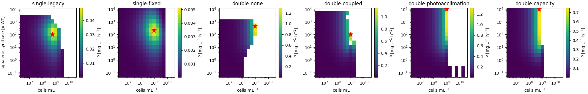
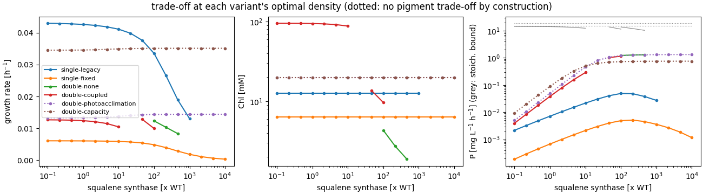
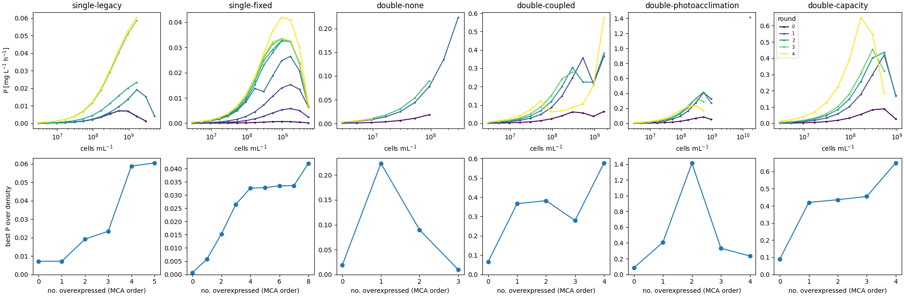

# Maximal squalene productivity of a culture: the squalene/pigment trade-off

Scripts: `scripts/productivity_analysis.py` (→ `productivity.json`),
`scripts/plot_productivity.py`.

## Question

What is the maximal production rate of squalene **per culture volume**? Diverting FPP
into squalene takes precursors away from the pigments (Chl, carotenoids) that the cells
need to harvest light and grow. More squalene per cell therefore means fewer and/or
slower-growing cells. The optimum is a trade-off at the culture level, not the
single-cell maximum.

## Which variants can answer it

The trade-off needs two links: (1) squalene synthesis competes with pigment synthesis for
FPP/GGPP, and (2) pigment synthesis feeds back on growth.

| variant | link 1 (FPP competition) | link 2 (pigments → growth) | can answer? |
| --- | --- | --- | --- |
| single-legacy | yes | **empirical** growth law μ ∝ v_Chl; Chl content itself is pinned (ADR 0002) | yes, via the growth law |
| single-fixed (not recalibrated) | yes | same law | yes, but not recalibrated: absolute numbers meaningless |
| double-none | yes | **mechanistic**: Chl content = v_Chl/μ sets light absorption per cell; self-shading of the culture | yes |
| double-coupled | yes | mechanistic, pigment enzymes additionally scale with growth | yes |
| double-photoacclimation (retired; fitted a ≈ 0) | yes | **none**: pigment contents fixed by construction | no: only carbon cost (control) |
| double-capacity (retired) | yes | **none**: pigment contents fixed by construction | no: only carbon cost (control) |

## Setting

Continuous culture (turbidostat) at steady state: the operator chooses the cell density
N; growth rate μ, pigment and squalene contents follow. Squalene leaves the cells only by
growth dilution, so the volumetric productivity is

    P = v_sq · N · V_cell · M_SQ        [mg L(culture)^-1 h^-1]

Scan: squalene synthase level 0.1–10^4 × WT (`single`: its synthesis rate; `double`: its level) ×
cell density 3e6–3e10 cells mL^-1 (3e9 ≈ OD 30, roughly the practical limit), at 100 µmol m^-2 s^-1 and 1 cm light path (Fig 12
conditions), Δshc strain. `double` also gets a **stoichiometric bound**: all 3PGA
supplied at that density converted to squalene (12 3PGA per squalene).

## Results

| variant | pigment trade-off | P max [mg/L/h] | at Sqs [x WT] | at density [cells/mL] | μ at optimum [1/h] | P at WT Sqs [mg/L/h] | gain | stoich. bound [mg/L/h] |
|:--|:--|--:|:--|--:|--:|--:|--:|--:|
| single-legacy | yes | 0.049 | 100 | 5.3e8 | 0.034 | 0.0071 | 6.8 | – |
| single-fixed | yes | 0.0051 | 215 | 9.5e8 | 0.004 | 0.0007 | 7.6 | – |
| double-none | yes | 1.30 | 464 | 9.5e8 | 0.008 | 0.018 | 70 | 10.2 |
| double-coupled | yes | 1.15 | 100 | 9.5e8 | 0.010 | 0.065 | 18 | 11.4 |
| double-photoacclimation | no (fixed) | 1.32 | ≥ 10^4 (scan edge) | 9.5e8 | 0.014 | 0.085 | 16 | 14.8 |
| double-capacity | no (fixed) | 0.75 | ≥ 10^4 (scan edge) | 5.3e8 | 0.035 | 0.089 | 8.4 | 18.7 |

("gain": P max over P at WT squalene synthase level, each at its best density.)

## Interpretation

1. **The trade-off produces an interior optimum, and only the variants with the pigment
   link find one.** single-legacy, single-fixed, double-none and double-coupled peak at 100–460× WT squalene synthase;
   beyond that, pigment synthesis and growth collapse and productivity falls. The two
   controls without the pigment link (`double-photoacclimation`, `double-capacity`, now
   retired) saturate at the carbon supply and never
   turn over: they would wrongly suggest "more Sqs is always better".
2. **There is also an optimal culture density** (5e8–1e9 cells mL^-1 in all variants):
   below it there are too few cells, above it self-shading starves them.
3. **How the trade-off acts differs between the families.** In `single` Chl content is pinned
   by the empirical growth law (flat line in the middle panel); the trade-off acts only
   through the Chl *synthesis flux* entering the growth law. In `double` the Chl *content*
   drops (light harvesting per cell falls) and the culture can then hold more cells
   before self-shading. That is the mechanism the original question was about.
4. **Magnitude.** `double` predicts up to ~1.2–1.3 mg L^-1 h^-1 (~30 mg L^-1 d^-1) at the
   optimum, ~10 % of the stoichiometric carbon bound at that density. single-legacy predicts 25x less
   (0.05 mg L^-1 h^-1); its absolute squalene level isn't calibrated (2 fL cells, legacy
   units), while `double`'s reference uses the sqs strain's measured squalene content. The
   *relative* gain from optimising Sqs and density is ~7x in `single` and 18–70x in
   `double`.

**Answer for a turbidostat (with the models at that time; ADR 0006 moves the main
target to a batch culture):** the culture-level optimum
exists and lies at strong squalene synthase overexpression (~100–500× WT) in a dense
turbidostat (~1e9 cells mL^-1), giving ~1.2 mg L^-1 h^-1 in the mechanistic `double`
variants. The exact optimum position is model-dependent; its existence is not, as long as
pigment synthesis feeds back on growth.

## Best setting from the MCA overexpression sequence

The squalene synthase scan above varies one enzyme freely. The MCA strain optimisation
(`04-strain-optimisation.md`) instead proposes a *sequence* of realistic overexpressions
(proteomics-based fold changes, each enzyme at most once, a step only with positive
control on the score and on the squalene content). Here each strain of that sequence
(round k = first k overexpressions) is evaluated for **culture productivity** over the
same density scan (`productivity_analysis.py --strains` → `productivity-strains.json`).

| variant | best strain | P max [mg/L/h] | at density [cells/mL] | μ [1/h] | P WT [mg/L/h] | gain | P after 1 OX |
|:--|:--|--:|--:|--:|--:|--:|--:|
| single-legacy | IspG, DXS, IspD, Sqs, Idi | 0.060 | 1.7e9 | 0.040 | 0.0071 | 8.5 | 0.0071 |
| single-fixed | DXS, Sqs, CrtB, IspD, IspG, IspF, IspE, DXR | 0.042 | 9.5e8 | 0.021 | 0.0007 | 62 | 0.0058 |
| double-none | Sqs (later strains converge only up to 1.7e8) | 0.22 | 3e8 | 0.030 | 0.018 | 12 | 0.22 |
| double-coupled | Sqs, CrtE, MEP, DXS | 0.58 | 1.7e9 | 0.014 | 0.065 | 8.9 | 0.37 |
| double-photoacclimation (retired) | Sqs, CrtE | 1.41 | 1.7e10 | 0.004 | 0.085 | 17 | 0.41 |
| double-capacity (retired) | Sqs, CrtE, MEP, DXS | 0.65 | 1.7e8 | 0.10 | 0.089 | 7.3 | 0.42 |

- **Sequences now stop by themselves** (positive-control rule, report 04): after 3–4
  steps in `double` and minimal-m0, 5 in single-legacy and 8 in single-fixed. The pigment-enzyme steps that used to
  end every sequence (CrtB, Chl) are gone, except in minimal-m0 with capacity acclimation.
- **More overexpressions still isn't always better.** Steps with positive control at the
  MCA condition (1e7 cells mL^-1) can lower productivity at the productive high
  densities: double-photoacclimation peaks after 2 of 4 steps (Sqs, CrtE), minimal-m0 after 1–2. The
  MCA criterion and the culture objective agree on the first steps, not on when to stop.
- **Best strains:** `double` says **Sqs + CrtE** (most of the gain), then the MEP chain
  and DXS (the maximum in double-coupled and double-capacity); single-legacy the legacy IspG/DXS/IspD/Sqs set
  (+ Idi); single-fixed DXS/Sqs/CrtB plus the MEP enzymes. The best density shifts upward with the
  overexpressions (1.7e9 cells mL^-1; double-photoacclimation 1.7e10, beyond the practical
  OD ~30), except in double-capacity (1.7e8), where capacity acclimation penalises shading.
- **double-none's strain result isn't reliable**: from round 2 on its strains converge only
  up to 1.7e8 cells mL^-1 (dark trap), so its best strain is the Sqs-only strain at 3e8.
- **Realistic vs. free optimum:** with proteomics-based folds, `double` reaches
  0.58–0.65 mg L^-1 h^-1 in the regulated variants (double-coupled, double-capacity) at practical densities, about half of the free squalene synthase optimum (1.2–1.3, at
  100–460x WT Sqs, which no promoter delivers).
- double-none (26/68 converged) and double-coupled (57/85) have gaps (white/broken lines): their
  maxima are less reliable than those of `single` and the fixed-pigment variants.

## Caveats

- **No protein cost in `double`**: enzyme levels are free, so very high Sqs levels are
  only penalised through FPP competition. Proteome allocation would shift the optimum to
  lower overexpression. `single` includes enzyme synthesis costs (cofactor consumption).
- **Convergence gaps**: double-none fails in the dense/low-Sqs corner (116 of 208 points), the
  "dark trap" of unregulated pigments (no steady state with growth); double-coupled and single-legacy lose
  points at the highest density. Gaps are white in the maps.
- **Only steady growth**: production in non-growing phases (two-stage processes, the Fig 11
  induction scenario) isn't covered; there the dilution-based productivity formula
  doesn't apply.
- Only the squalene synthase level is varied. Precursor supply (DXS, MEP chain, CrtE) and
  pigment-branch knock-downs could move the optimum further (combinations: Fig 12
  strain-optimisation report).
- single-fixed is not recalibrated; double-none relies on the unregulated pigment model that runs into
  the dark trap.

> Updated (1) with the density scan extended to 3e10 cells mL^-1 (report 06): the free
> squalene-synthase optima are unchanged; and (2) with the positive-control rule of the
> MCA sequence (report 04), which shortened the sequences and changed the single-legacy, single-fixed and
> double-none strain results.
