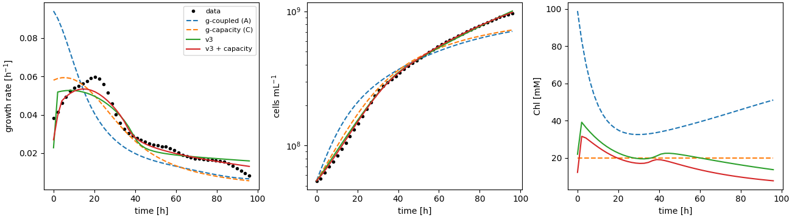
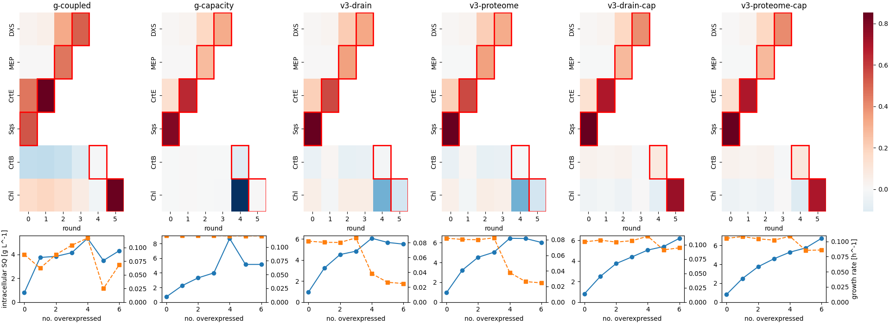
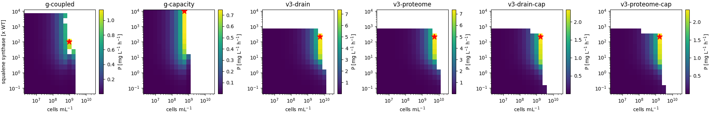
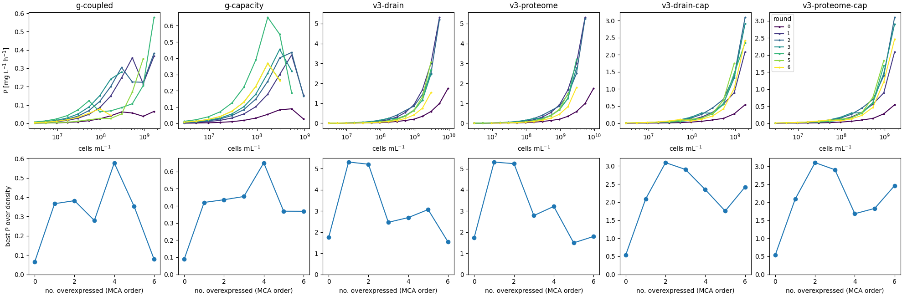

# Minimal model v3: batch fit, strain optimisation and culture productivity

Design: ADR 0005. Code: `synmep.models.v3_minimal`. Scripts: `fit_petc_closed_form.py`,
`fit_v3.py [--capacity]`, `plot_v3_fit.py`, `strain_optimisation.py v3-…`,
`productivity_analysis.py [--strains] v3-…`, and the plot scripts with `--v3`.

## What v3 is

v3 is built from thread g (report 03) with three reductions and two additions:

| element | thread g | v3 |
| --- | --- | --- |
| PETC | degree-5 polynomial in 4 inputs, ray extension in dark layers | closed form (8 parameters): tanh light response, quadratic J_ATP(J_3PGA) |
| metabolism in the growth model | degree-6 polynomial surrogate (only E_CrtE as enzyme input) | the 7-pool ODE itself, all enzymes |
| pigments | 4 regulation variants | growth-coupled pigment enzymes (A), exponent fitted |
| dry weight per cell volume | 970 g L^-1 (gravimetric) | 464 g L^-1 (from measured protein) |
| enzyme cost | none | `drain` (precursor drain) or `proteome` (displaced capacity) |
| capacity acclimation | variant C only (with fixed pigments) | optional, together with the pigment dynamics |

Variants: `v3-drain`, `v3-proteome`, `v3-drain-cap`, `v3-proteome-cap`. The same model
runs batch (dN/dt = μN), turbidostat (fixed N) and MCA. One steady state takes ~2 s, a
strain optimisation 3 s, a batch fit 15–25 s.

## Dry weight vs. cell volume

| per cell (median of 36 proteomics samples) | value | at 4 fL |
| --- | --- | --- |
| gravimetric dry weight | 3.88 pg | 0.97 g mL^-1 (cells: ~0.3–0.5) |
| measured protein | 0.83 pg | 0.21 g mL^-1 |
| protein / dry weight | **0.22** | Synechocystis: ~0.45–0.55 |

The measured protein, the cell-count calibration and 4 fL agree with a normal cell
composition; the gravimetric dry weight doesn't. My suggestion, implemented in v3: take
the dry weight from the protein (0.83 pg / 0.445 = 1.85 pg, 464 g L^-1, i.e.
0.20 gDW L^-1 OD^-1, in the usual range for Synechocystis), and keep 4 fL and the
cells/OD calibration. What depends on it:
- μ per unit carbon supply (doubles): absorbed by the fitted PETC efficiency.
- the proteomics enzyme concentrations (~2× too high when built from DW × 0.445): v3 uses
  only the basis-free proteome fractions f_i.
- open: 7.5 mg Chl OD^-1 L^-1 (source unknown) is then 3.8 % of dry weight, high for
  Synechocystis (1–2 %). Worth checking against the measured spectra.

## Closed-form PETC

Fitted to the 3939 pfennig2024 steady states of the PETC surrogate training (80/20
split): I = a_PS1 + 10.3 a_PS2 + 15.4 a_PBS, J_3PGA = 19.8 tanh(I / 19325) − 0.29,
J_ATP = 1.62 − 0.007 J_3PGA + 0.071 J_3PGA².

| output | hold-out R², closed form | degree-5 polynomial |
| --- | --- | --- |
| J_3PGA | 0.998 | 0.983 |
| J_ATP | 0.979 | 0.939 |

## Batch fit (Fig 9 data)

| model | fitted | RMSE μ [h^-1] | RMSE ln N |
| --- | --- | --- | --- |
| g-coupled (A) | petc 1.25, pbs 9.13 | 0.0164 | 0.228 |
| g-capacity (C) | petc 2.57, pbs 1.89, K 59, τ 6000 min | 0.0077 | 0.141 |
| legacy v0 | – | 0.0053 | 0.135 |
| **v3** | petc 5.0 (bound), pbs 0.44, c 5.2 | **0.0050** | **0.041** |
| **v3 + capacity** | petc 2.85, pbs 0.54, c 8.7, K 100 (bound), τ 945 min | **0.0033** | **0.023** |

Fitted within bounds (pbs_scale in the PETC training range 0.25–4, petc_scale 0.2–5);
least squares from the 3 best points of a start grid.

- **Both v3 fits beat every earlier model, v0 included**, with 3 (5) parameters.
- **v3 reproduces the initial growth rise**, which no thread-g variant could. Its
  mechanism is the fitted strong coupling of pigment synthesis to growth (c = 5–9): the
  slowly growing, dense pre-culture carries little Chl (12–22 mM); after dilution growth
  and pigment synthesis rise together. That is the opposite direction to classic
  photoacclimation (more Chl in dim light), and there are no pigment time courses in the
  repo to test it. With capacity acclimation the rise is spread over ~10 h.
- petc_scale and pbs_scale trade off against each other (only their product, ~1.5–2.2,
  is constrained by the batch data); petc_scale sits at its upper bound without capacity
  acclimation.
- capacity_K → 100 means capacity proportional to absorbed light per Chl.

## Strain optimisation (Fig 12 protocol, each enzyme once)

| variant | order | SQ start → after 1 [g/L] | μ start → end [1/h] |
| --- | --- | --- | --- |
| g-coupled | Sqs, CrtE, MEP, DXS, CrtB, Chl | 0.79 → 3.74 | 0.087 → 0.068 |
| g-capacity | Sqs, CrtE, MEP, DXS, CrtB, Chl | 0.72 → 2.25 | 0.121 → 0.120 |
| v3-drain | Sqs, CrtE, MEP, DXS, CrtB, Chl | 0.94 → 3.22 | 0.082 → 0.025 |
| v3-proteome | Sqs, CrtE, MEP, DXS, CrtB, Chl | 0.94 → 3.22 | 0.082 → 0.025 |
| v3-drain-cap | Sqs, CrtE, MEP, DXS, CrtB, Chl | 0.81 → 2.48 | 0.105 → 0.095 |
| v3-proteome-cap | Sqs, CrtE, MEP, DXS, CrtB, Chl | 0.81 → 2.49 | 0.105 → 0.086 |

The same order as thread g in every v3 variant. Overexpressing DXS (round 4) halves
growth in v3 without capacity acclimation.

## Culture productivity

Turbidostat, 100 µmol m^-2 s^-1, 1 cm, Δshc; squalene synthase 0.1–1e4× × density
3e6–3e10 cells mL^-1 (report 05 setting, range extended).

| variant | P max [mg/L/h] | at Sqs [× WT] | at density [cells/mL] | μ [1/h] | P at WT Sqs | gain |
| --- | --: | --: | --: | --: | --: | --: |
| g-coupled | 1.15 | 100 | 9.5e8 | 0.010 | 0.065 | 18 |
| v3-drain | 7.39 | 215 | 5.3e9 | 0.018 | 1.75 | 4.2 |
| v3-proteome | 7.39 | 215 | 5.3e9 | 0.017 | 1.75 | 4.2 |
| v3-drain-cap | 2.34 | 215 | 1.7e9 | 0.033 | 0.54 | 4.4 |
| v3-proteome-cap | 2.35 | 215 | 1.7e9 | 0.032 | 0.54 | 4.4 |

Best strain from the MCA sequence:

| variant | best strain | P max [mg/L/h] | at density [cells/mL] | μ [1/h] | gain vs WT |
| --- | --- | --: | --: | --: | --: |
| g-coupled | Sqs, CrtE, MEP, DXS | 0.58 | 1.7e9 | 0.014 | 8.9 |
| g-capacity | Sqs, CrtE, MEP, DXS | 0.65 | 1.7e8 | 0.10 | 7.3 |
| v3-drain | Sqs | 5.31 | 5.3e9 | 0.015 | 3.0 |
| v3-proteome | Sqs | 5.32 | 5.3e9 | 0.015 | 3.0 |
| v3-drain-cap | Sqs, CrtE | 3.09 | 1.7e9 | 0.023 | 5.7 |
| v3-proteome-cap | Sqs, CrtE | 3.10 | 1.7e9 | 0.023 | 5.8 |

Findings:
1. **Optimum in squalene synthase: interior, at ~200× WT** in all four variants (thread
   g: 100–460×). Higher levels lose the steady state (white region above ~500–700×).
2. **The density optimum is at the edge of the converged region**: productivity rises
   up to the densest culture with a steady state, beyond which none was found. Without
   capacity acclimation that is 5.3e9 cells mL^-1 (OD ~50, beyond practical cultures);
   with it 1.7e9 (OD ~16). So v3 without capacity acclimation says "as dense as
   possible", which thread-g-coupled didn't.
3. **The enzyme-cost formulation doesn't matter at these overexpressions**: drain and
   proteome cost differ by < 0.3 % in P. At the free optimum (215×) the extra protein
   is only 3 % of the proteome, and near the optimum the cells have nearly no pigment
   left (v3, 464× Sqs, 1.7e9 cells mL^-1: Chl ~0.3 mM vs. 13.5 in WT, PETC saturated
   per Chl); a costlier cell keeps a bit
   more Chl and compensates. The cost only bites above ~10^3×, where no steady state
   exists anyway.
4. **Capacity acclimation matters a lot for the answer** (factor 3 in P, factor 3 in the
   best density): it penalises the shaded cells of dense cultures.
5. **Best realistic strain: Sqs + CrtE with capacity acclimation** (as in thread g);
   without it Sqs alone, further overexpressions lower P (DXS halves growth).
6. **Magnitude**: 2.3–7.4 mg L^-1 h^-1 (free), 3.1–5.3 (realistic strains), 2–6× thread g.
   Mostly the denser optimum and the halved dry-weight density (more growth per carbon).
   Squalene is 8–13 % of the stoichiometric carbon bound at the free optimum.

## Acceptance criteria (ADR 0005 §2.4)

| criterion | v3 | v3 + capacity |
| --- | --- | --- |
| batch RMSE μ ≤ 0.0085, ln N ≤ 0.155 | met (0.0050 / 0.041) | met (0.0033 / 0.023) |
| first three overexpressions Sqs, CrtE, MEP/DXS | met | met |
| interior optimum in Sqs level | met (215×) | met (215×) |
| interior optimum in density | **not met** (edge of steady states, 5.3e9) | edge of steady states, but at a practical density (1.7e9) |
| within ~2× of thread g's optimum | **not met** (6.4×) | met (2.0×) |
| same best realistic strain (Sqs + CrtE …) | partly (Sqs only) | met (Sqs + CrtE) |

**Recommendation: `v3-proteome-cap` (or `-drain-cap`, equivalent) as the minimal
model.** It meets all criteria except a true interior density optimum.

## Caveats

- The fitted pigment coupling (c = 5–9) drives both the good batch fit and the near
  pigment-free cells at the productivity optimum; it is constrained only by growth data.
  Pigment time courses (Chl per cell over the batch, and in Sqs strains) would test it.
- The density optimum is set by where steady states stop existing (or stop being found
  from the continuation); whether that's a real washout boundary or a solver limit isn't
  checked yet.
- Only steady growth; no two-stage processes.
- petc_scale / pbs_scale aren't separately identifiable from batch data.
