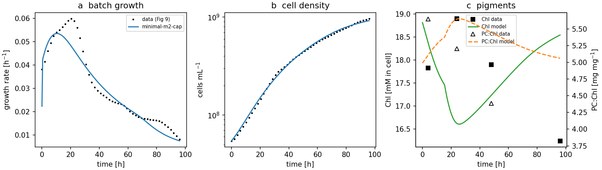
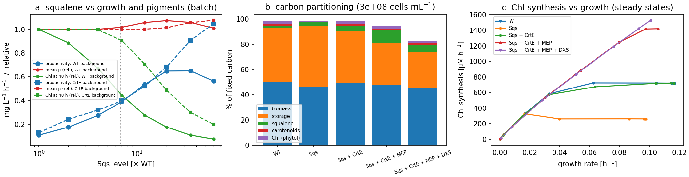
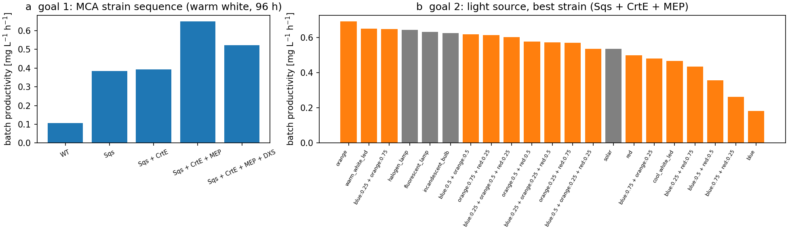

# Report 15: executive report

**Status:** 2026-11-17 (after report 14); updated after every follow-up. Figures:
`scripts/executive_figures.py`.

## Recommendation: `minimal-m2-cap`

- **Best fit:** AIC 69 (`minimal-m0-cap` 73), RMSE μ 0.0050 h⁻¹, Chl −12 to +14 %,
  PC:Chl −10 to +32 %.
- **Gates:** passes 2 and 3; all 93 goal runs converge.
- **Why m2:** explicit PS1/PS2 balance (needed for the light follow-up).
  `minimal-m0-cap` gives the same answers (cheaper fallback).
- **Caveats:**
  - `petc_r` and `capacity_K` end at their lower bounds.
  - GGPP accumulates in dense cultures (77 mM at 10⁹ cells mL⁻¹).

## Structure

- **Light:** absorption by Chl, carotenoids and phycobilisomes in 5 depth layers
  (self-shading).
- **Electron transport:** three redox pools per layer (PQ, PC, Fd) supply 3PGA, ATP
  and NADPH. A slow capacity state, driven by PS1 flux, scales this supply.
- **Growth:** μ = biomass synthesis / dry weight. Surplus 3PGA goes to storage.
- **MEP pathway:** DXS (IPP/DMAPP feedback), lumped MEP chain, CrtE (FPP, GGPP);
  sinks Sqs, carotenoids (CrtB), Chl (phytol).
- **Pigments:** made in proportion to growth, scaled by photoacclimation (PS2
  excitation, 0.5–1.5×) and limited by GGPP.
- **Enzyme cost:** overexpressed protein displaces proteome (growth, capacity).
- **Fitted (6):** PETC efficiency, phycobilisome level, photoacclimation exponent,
  respiration, capacity K and τ.

## Does it support the paper's story?

| claim | verdict |
| --- | --- |
| Squalene and pigments compete for precursors | ✓ In dilute culture, Sqs 6.8× cuts Chl from 6.1 to 2.6 mM and μ by 16 %; adding CrtE restores both |
| Chl synthesis follows growth linearly | partly: all strains share one line until GGPP limits (WT plateau above 0.06 h⁻¹). Built in, not predicted |
| Pigment loss limits productivity | only in dilute culture. In the batch, Sqs 60× cuts Chl at 48 h by 93 % while mean μ changes ≤ 8 %: less self-shading compensates. Productivity peaks at Sqs 20–35× (none up to 60× with CrtE) |
| MCA finds the targets | ✓ Sqs → CrtE → MEP (DXS: no gain). Best strain: 0.65 mg L⁻¹ h⁻¹ and 39 mg L⁻¹ in 96 h, 6× WT |
| Share of fixed carbon at 3×10⁸ cells mL⁻¹ | squalene 1.6 % (WT) to 9.6 % (best strain), pigments 3.4 %, biomass ~48 %, storage 34–43 %. Enzyme cost is a proteome share, not carbon |

**Verdict:** the precursor competition and the MCA targets hold. The growth argument
needs reframing: losing pigment costs growth only when light is not limiting. In dense
production cultures, a smaller antenna is nearly neutral, so precursor supply (MEP
flux, storage overflow) caps squalene, not pigments.

## Next steps

1. Widen the `petc_r` and `capacity_K` bounds, refit.
2. GGPP outlet for dense cultures.
3. Test the reframed growth claim on the CrtE knock-down turbidostat data.
