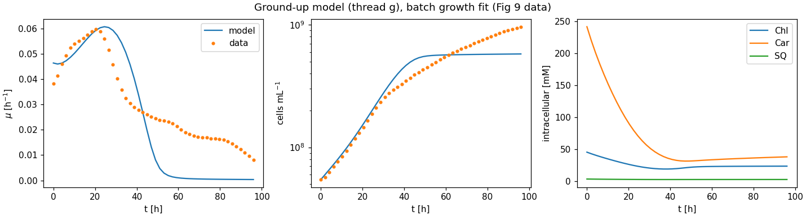

# Ground-up three-timescale model (thread "g"): status

Design: ADR 0004. Code: `synmep.petc.pfennig`, `synmep.models.g_metabolism`,
`synmep.models.g_growth`, `synmep.surrogates.poly`; scripts `train_petc_surrogate.py`,
`train_metabolism_surrogate.py`, `fit_g_growth.py`.

## Pipeline

| Layer      | Model                                     | Surrogate (inputs → outputs)                         | Training                         | Hold-out accuracy |
| ---------- | ----------------------------------------- | ---------------------------------------------------- | -------------------------------- | ----------------- |
| PETC (s)   | pfennig2024, native-lowerable, 3PGA clamped | 4 absorbed-light inputs → J_3PGA, J_ATP (degree 5) | 4000 culture states via the light model, ~1 min | R² 0.976 / 0.925 |
| metabolism (min) | 7-pool ODE, saturable kinetics       | S_PGA, S_ATP, E_CrtE → μ, Chl*, Car*, SQ* (degree 6, log-log) | 4000 physically produced supplies, ~1.5 min | median 3 %, p95 16–21 % |
| growth (h) | N, Chl, Car, SQ ODEs                      | —                                                    | fit: 2 parameters, ~25 s         | see below         |

## Fit to the batch data (Fig 9 data)

| | value |
| --- | --- |
| fitted `petc_scale` (PETC supply efficiency) | 5.48 |
| fitted `pbs_scale` (phycobiliprotein content factor) | 1.26 |
| RMSE μ | 0.013 h^-1 (legacy model: not fitted) |
| RMSE ln N | 0.23 |

What works:
- Growth emerges from the carbon/energy balance with the right magnitude.
- The **acclimation rise** after dilution from the dense pre-culture and the **peak**
  (0.06 h^-1 at ~22 h) are reproduced: cells start with high pigment contents
  acclimated to the dark pre-culture, and growth rises as pigments are diluted.

What doesn't:
1. **Growth collapses after ~50 h** (data: gradual decline to 0.008 h^-1). The PETC is
   evaluated at the *depth-averaged* light. In a dense culture that falls below the
   compensation point, net respiration exceeds fixation and supply hits the floor, while
   a real culture keeps growing in its illuminated outer layer. The PETC response is
   nonlinear, so the mean of the rates isn't the rate at the mean light. The legacy model
   has the same flaw.
2. **Pigments are unregulated.** At low supply, pigment synthesis outcompetes biomass
   synthesis, so steady-state contents rise strongly: carotenoids are ~240 mM in the
   dark pre-culture (reference 8 mM). Real cells acclimate pigments only moderately.
3. **`petc_scale` = 5.5 is large.** A plausible part of it is the dry-weight
   inconsistency (ADR 0004 §2.6): 0.97 g DW per mL of cell, ~3× the physiological value,
   would overestimate biomass demand per cell by the same factor.
4. Surrogate accuracy is limited by global polynomials (kinks at limitation switches).

## Next steps (proposed)

1. Depth-resolved PETC: evaluate the PETC surrogate at a few depths (Gauss–Legendre,
   3–5 nodes) of the light profile and average the outputs.
2. Pigment regulation: growth-coupled expression of the pigment branch (or an explicit
   photoacclimation term). This is a modelling choice to make together.
3. Resolve the dry-weight / cell-volume inconsistency before interpreting `petc_scale`.
4. Then Figs 10–12 for this thread (Fig 12 via the coupled ODE model, not the surrogate).
