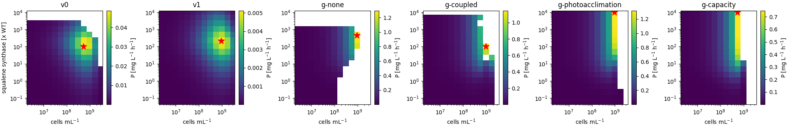
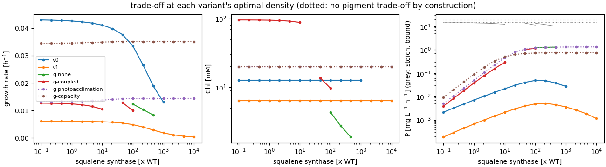

# Maximal squalene productivity of a culture: the squalene/pigment trade-off

Scripts: `scripts/productivity_analysis.py` (→ `productivity.json`),
`scripts/plot_productivity.py`.

## Question

What is the maximal production rate of squalene **per culture volume**? Diverting FPP
into squalene takes precursors away from the pigments (Chl, carotenoids) that the cells
need to harvest light and grow. More squalene per cell therefore means fewer and/or
slower-growing cells. The optimum is a trade-off at the culture level, not the
single-cell maximum.

## Which variants can answer it

The trade-off needs two links: (1) squalene synthesis competes with pigment synthesis for
FPP/GGPP, and (2) pigment synthesis feeds back on growth.

| variant | link 1 (FPP competition) | link 2 (pigments → growth) | can answer? |
| --- | --- | --- | --- |
| v0 (legacy) | yes | **empirical** growth law μ ∝ v_Chl; Chl content itself is pinned (ADR 0002) | yes, via the growth law |
| v1 (bugs fixed) | yes | same law | yes, but not recalibrated: absolute numbers meaningless |
| g, unregulated (`none`) | yes | **mechanistic**: Chl content = v_Chl/μ sets light absorption per cell; self-shading of the culture | yes |
| g, A (`coupled`) | yes | mechanistic, pigment enzymes additionally scale with growth | yes |
| g, B (`photoacclimation`, fitted a ≈ 0) | yes | **none**: pigment contents fixed by construction | no: only carbon cost (control) |
| g, C (`capacity`) | yes | **none**: pigment contents fixed by construction | no: only carbon cost (control) |

## Setting

Continuous culture (turbidostat) at steady state: the operator chooses the cell density
N; growth rate μ, pigment and squalene contents follow. Squalene leaves the cells only by
growth dilution, so the volumetric productivity is

    P = v_sq · N · V_cell · M_SQ        [mg L(culture)^-1 h^-1]

Scan: squalene synthase level 0.1–10^4 × WT (v0/v1: its synthesis rate; g: its level) ×
cell density 3e6–3e9 cells mL^-1, at 100 µmol m^-2 s^-1 and 1 cm light path (Fig 12
conditions), Δshc strain. Thread g also gets a **stoichiometric bound**: all 3PGA
supplied at that density converted to squalene (12 3PGA per squalene).

## Results

| variant | pigment trade-off | P max [mg/L/h] | at Sqs [x WT] | at density [cells/mL] | μ at optimum [1/h] | P at WT Sqs [mg/L/h] | gain | stoich. bound [mg/L/h] |
|:--|:--|--:|:--|--:|--:|--:|--:|--:|
| v0 | yes | 0.049 | 100 | 5.3e8 | 0.034 | 0.0071 | 6.8 | – |
| v1 | yes | 0.0051 | 215 | 9.5e8 | 0.004 | 0.0007 | 7.6 | – |
| g-none | yes | 1.30 | 464 | 9.5e8 | 0.008 | 0.018 | 70 | 10.2 |
| g-coupled | yes | 1.15 | 100 | 9.5e8 | 0.010 | 0.065 | 18 | 11.4 |
| g-photoacclimation | no (fixed) | 1.32 | ≥ 10^4 (scan edge) | 9.5e8 | 0.014 | 0.085 | 16 | 14.8 |
| g-capacity | no (fixed) | 0.75 | ≥ 10^4 (scan edge) | 5.3e8 | 0.035 | 0.089 | 8.4 | 18.7 |

("gain": P max over P at WT squalene synthase level, each at its best density.)

## Interpretation

1. **The trade-off produces an interior optimum, and only the variants with the pigment
   link find one.** v0, v1, g-none and g-coupled peak at 100–460× WT squalene synthase;
   beyond that, pigment synthesis and growth collapse and productivity falls. The two
   controls without the pigment link (B, C) saturate at the carbon supply and never
   turn over: they would wrongly suggest "more Sqs is always better".
2. **There is also an optimal culture density** (5e8–1e9 cells mL^-1 in all variants):
   below it there are too few cells, above it self-shading starves them.
3. **How the trade-off acts differs between the threads.** In v0/v1 Chl content is pinned
   by the empirical growth law (flat line in the middle panel); the trade-off acts only
   through the Chl *synthesis flux* entering the growth law. In thread g the Chl *content*
   drops (light harvesting per cell falls) and the culture can then hold more cells
   before self-shading. That is the mechanism the original question was about.
4. **Magnitude.** Thread g predicts up to ~1.2–1.3 mg L^-1 h^-1 (~30 mg L^-1 d^-1) at the
   optimum, ~10 % of the stoichiometric carbon bound at that density. v0 predicts 25x less
   (0.05 mg L^-1 h^-1); its absolute squalene level isn't calibrated (2 fL cells, legacy
   units), while thread g's reference uses the sqs strain's measured squalene content. The
   *relative* gain from optimising Sqs and density is ~7x in v0/v1 and 18–70x in
   thread g.

**Answer to the original question (with the current models):** the culture-level optimum
exists and lies at strong squalene synthase overexpression (~100–500× WT) in a dense
turbidostat (~1e9 cells mL^-1), giving ~1.2 mg L^-1 h^-1 in the mechanistic thread-g
variants. The exact optimum position is model-dependent; its existence is not, as long as
pigment synthesis feeds back on growth.

## Caveats

- **No protein cost in thread g**: enzyme levels are free, so very high Sqs levels are
  only penalised through FPP competition. Proteome allocation would shift the optimum to
  lower overexpression. v0/v1 include enzyme synthesis costs (cofactor consumption).
- **Convergence gaps**: g-none fails in the dense/low-Sqs corner (116 of 208 points), the
  "dark trap" of unregulated pigments (no steady state with growth); g-coupled and v0 lose
  points at the highest density. Gaps are white in the maps.
- **Only steady growth**: production in non-growing phases (two-stage processes, the Fig 11
  induction scenario) isn't covered; there the dilution-based productivity formula
  doesn't apply.
- Only the squalene synthase level is varied. Precursor supply (DXS, MEP chain, CrtE) and
  pigment-branch knock-downs could move the optimum further (combinations: Fig 12
  strain-optimisation report).
- v1 is not recalibrated; g-none relies on the unregulated pigment model that runs into
  the dark trap.
